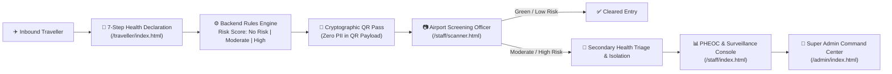

# 🇬🇲 OutbreakWatch — Ebola Traveller Screening & QR Code Verification System
### Ministry of Health, Republic of The Gambia &bull; Port Health & Border Clearance

[](https://www.python.org/)
[](https://fastapi.tiangolo.com/)
[](https://supabase.com/)
[](https://tailwindcss.com/)
[](tests/test_screening.py)

OutbreakWatch is an end-to-end digital public health surveillance and border health clearance platform designed for the **Ministry of Health, The Gambia**, operating across **Banjul International Airport (BJL)** and terrestrial border entry posts.

The system automates traveller epidemiological declarations, computes clinical risk profiles via an automated rule engine, issues cryptographic high-entropy QR health passes, and provides dedicated role-based portals for border screening officers, epidemiologists, supervisors, auditors, and super administrators.

---

## 📌 Key Architectural Capabilities



1. **Self-Service Traveller Declaration:** 7-step guided questionnaire covering personal details, flight info, 21-day country transit history, direct contact questions, healthcare exposures, animal exposures, and vital symptom self-reports.
2. **Deterministic Risk Stratification:** Automatically calculates risk tier (`NO_RISK`, `MODERATE`, `HIGH`) based on WHO/CDC epidemiological incubation thresholds and Gambian health directives.
3. **Zero-PII Cryptographic QR Pass:** Generates a high-entropy 192-bit opaque token hashed using SHA-256. No personally identifiable information (PII) is encoded in the QR code itself, ensuring strict GDPR / data protection compliance.
4. **Live Optical QR Scanner:** In-browser HTML5 camera scanner for airport health authorities to instantly verify passenger clearance upon arrival.
5. **Multi-Role RBAC Portals:** Distinct portals and dashboards partitioned across 5 administrative security tiers with tamper-evident audit trails.

---

## 🗂️ Project Directory Structure

```text
OutbreakWatch/
├── .env.example                 # Environment variables template
├── .gitignore                   # Git ignore patterns for Python, virtual environments, and secrets
├── README.md                    # Project documentation & onboarding guide
│
├── backend/                     # Python FastAPI Backend
│   ├── app/
│   │   ├── api/v1/              # Versioned API routes
│   │   │   ├── endpoints/       # Endpoint handlers (auth, declaration, qr, staff, admin)
│   │   │   └── router.py        # Central API router aggregator
│   │   ├── core/                # Core configurations & database client factories
│   │   │   ├── config.py        # App configuration & environment loader
│   │   │   └── supabase.py      # Supabase connection manager & mock-memory fallback
│   │   ├── schemas/             # Pydantic validation models
│   │   │   ├── auth.py          # User authentication & token schemas
│   │   │   ├── declaration.py   # Traveller submission schemas
│   │   │   └── qr.py            # QR verification schemas
│   │   └── services/            # Business logic
│   │       ├── auth_service.py  # PBKDF2 password hashing & session management
│   │       ├── qr_service.py    # QR code generation & SHA-256 token hashing
│   │       └── rules_engine.py  # Epidemiological 21-day timeline risk evaluator
│   ├── main.py                  # Server entrypoint (run with: python main.py)
│   └── requirements.txt         # Pinned Python package dependencies
│
├── database/                    # Database Architecture & Migrations
│   ├── schema.sql               # Complete PostgreSQL / Supabase DDL schema with RLS & seed data
│   ├── migrations/              # Database schema migrations
│   └── seeds/                   # Seed data files
│
├── frontend/                    # Web Client (Vanilla JS, Tailwind CSS, FontAwesome)
│   ├── index.html               # Public health guidelines & emergency directives homepage
│   ├── traveller/               # Traveller Portal
│   │   ├── index.html           # 7-Step Health Declaration wizard with landing sky hero
│   │   └── confirmation.html    # Submission success screen & downloadable QR pass
│   ├── staff/                   # Port Health Authorities Portal
│   │   ├── login.html           # Staff authentication gateway
│   │   ├── index.html           # Health authorities surveillance dashboard
│   │   └── scanner.html         # Airport screening officer camera scanner
│   ├── admin/                   # Super Administrator Portal
│   │   ├── login.html           # Tier-1 Super Admin login
│   │   └── index.html           # Command Center (User provisioning, Audit logs, Risk rules)
│   └── assets/                  # Shared Static Assets
│       ├── css/style.css        # Government styling & responsive utilities
│       ├── js/api.js            # Unified REST client with localStorage auth state
│       ├── js/loader.js         # Flight trajectory progress animation module
│       └── images/              # Official Gambian emblem & graphics
│
└── tests/                       # Automated Test Suite
    └── test_screening.py        # End-to-end integration test (100% green verification)
```

---

## 👥 Pre-Seeded Roles & Default Credentials

The platform features strict Role-Based Access Control (RBAC). When the database is initialized with `database/schema.sql`, the following default test accounts are automatically available:

| Role | Title | Email | Default Password | Permitted Functions |
|---|---|---|---|---|
| **`super_admin`** | Super Administrator | `admin@health.gov.gm` | `Admin@2026!` | Full root authority: create/delete staff accounts, view immutable audit logs, configure outbreak countries, manage all queues. |
| **`screening_officer`** | Airport Screening Officer | `screening@health.gov.gm` | `Staff@2026!` | Camera QR scanning, verify passenger clearance status, record triage outcome (cleared / secondary referral). |
| **`surveillance_officer`**| Surveillance / Public Health Officer | `surveillance@health.gov.gm` | `Staff@2026!` | Review full clinical exposure details, assign 21-day monitoring, contact tracing, and quarantine orders. |
| **`supervisor`** | Public Health Supervisor | `supervisor@health.gov.gm` | `Staff@2026!` | Approve custom rule overrides, monitor health worker workload, review high-risk escalations and operational summaries. |
| **`auditor`** | Auditor / Data Protection Officer | `auditor@health.gov.gm` | `Staff@2026!` | Inspect immutable security audit trails, monitor data handling, verify policy compliance and export logs. |

---

## 🚀 Quickstart Guide for New Collaborators

Follow these steps after cloning the repository onto your machine:

### 1. Prerequisites
- **Python:** 3.10 or higher (`python --version`)
- **Web Browser:** Google Chrome, Edge, Firefox, or Safari

---

### 2. Environment Configuration
From the project root folder, copy the environment template:

```bash
# Windows (PowerShell / Command Prompt):
copy .env.example .env

# macOS / Linux (Bash):
cp .env.example .env
```

*(Note: The backend has pre-configured defaults and automatic mock-memory fallback, allowing team members to develop and test immediately without blocking on Supabase access).*

---

### 3. Running the Backend Server

Open a terminal in the project directory:

```bash
# 1. Navigate to backend directory
cd backend

# 2. Create a virtual environment (recommended)
python -m venv .venv

# 3. Activate the virtual environment
# Windows PowerShell:
.venv\Scripts\Activate.ps1
# Windows Command Prompt:
.venv\Scripts\activate.bat
# macOS / Linux:
source .venv/bin/activate

# 4. Install dependencies
pip install -r requirements.txt

# 5. Start the backend API server
python main.py
```

The terminal will display:
```text
============================================================
  OutbreakWatch Backend API is Starting...
  Open in your browser:  http://localhost:8000
  API Documentation:     http://localhost:8000/api/v1/docs
============================================================
INFO:     Uvicorn running on http://127.0.0.1:8000 (Press CTRL+C to quit)
```

> ⚠️ **Important (Windows Users):** Always access the backend using **`http://localhost:8000`** or **`http://127.0.0.1:8000`**. Do not type `0.0.0.0:8000` into your browser address bar, as Windows Chrome blocks `0.0.0.0` with `ERR_ADDRESS_INVALID`.

---

### 4. Running the Frontend Application

Open a **second terminal** window:

```bash
# 1. Navigate to frontend directory
cd frontend

# 2. Start local web server
python -m http.server 3000 --bind 127.0.0.1
```

The terminal will display:
```text
Serving HTTP on 127.0.0.1 port 3000 (http://127.0.0.1:3000/) ...
```

> 💡 **Note:** `http.server` will keep running in this terminal to actively serve files. Keep this terminal open and navigate to the URLs below in your browser.

---

### 5. Accessing the Application

With both servers running, open your browser to:

| View | Purpose | Local URL |
|---|---|---|
| **Public Portal** | National directives, symptom guides, and emergency hotlines | [http://localhost:3000/index.html](http://localhost:3000/index.html) |
| **Traveller Declaration** | 7-step passenger health form with sky hero background | [http://localhost:3000/traveller/index.html](http://localhost:3000/traveller/index.html) |
| **Clearance Pass** | Success confirmation with downloadable QR code | [http://localhost:3000/traveller/confirmation.html](http://localhost:3000/traveller/confirmation.html) |
| **Staff Portal** | Login for Screening Officers, Surveillance, Supervisors, & Auditors | [http://localhost:3000/staff/login.html](http://localhost:3000/staff/login.html) |
| **Authorities Dashboard** | Screening outcomes, referred cases, and triage review | [http://localhost:3000/staff/index.html](http://localhost:3000/staff/index.html) |
| **Camera QR Scanner** | Rapid optical verification for arrival gates | [http://localhost:3000/staff/scanner.html](http://localhost:3000/staff/scanner.html) |
| **Super Admin Login** | Tier-1 Administrative gateway | [http://localhost:3000/admin/login.html](http://localhost:3000/admin/login.html) |
| **Command Center** | User creation, role assignments, audit logs, and risk matrix | [http://localhost:3000/admin/index.html](http://localhost:3000/admin/index.html) |

---

## 🗄️ Supabase Database Setup

When connecting to Supabase:
1. Open your **Supabase Project Dashboard** &rarr; navigate to the **SQL Editor**.
2. Open [`database/schema.sql`](database/schema.sql) in this repository, copy its entire contents, and paste into the SQL editor.
3. Click **Run**.
4. The script is **100% idempotent** (`CREATE TABLE IF NOT EXISTS`, `ON CONFLICT DO NOTHING`) and safely provisions:
   - All tables (`roles`, `users`, `travellers`, `submissions`, `qr_tokens`, `audit_logs`, `outbreak_areas`)
   - Pre-seeded admin and staff user accounts
   - High-performance database indexes
   - Row-Level Security (RLS) policies

---

## 🧪 Running Automated Tests

A comprehensive integration test suite is included in [`tests/test_screening.py`](tests/test_screening.py). To verify that all components (auth, RBAC, declaration submission, rules evaluation, Supabase connectivity, and QR verification) are operating correctly:

```bash
# From project root:
python tests/test_screening.py
```

Expected output:
```text
[PASS] Health check passed
[PASS] Super Admin logged in successfully: Super Administrator
[PASS] Staff role 'screening_officer' authenticated: screening@health.gov.gm
[PASS] Staff role 'surveillance_officer' authenticated: surveillance@health.gov.gm
[PASS] Staff role 'supervisor' authenticated: supervisor@health.gov.gm
[PASS] Staff role 'auditor' authenticated: auditor@health.gov.gm
[PASS] Super Admin created staff account with role: screening_officer
[PASS] Newly created staff logged in successfully as Airport Screening Officer
[PASS] Audit trail verified: 8 tamper-evident audit events recorded
[PASS] Declaration registered: Ref=EB-2026-XXXXXX, Category=MODERATE
[PASS] QR Token verified: Passenger=Fatoumatta Jaiteh

>>> ALL TESTS (AUTHENTICATION, RBAC, DECLARATION, QR) PASSED WITH 100% SUCCESS! <<<
```

---

## 🛡️ Security & Privacy Architecture

- **Opaque QR Tokens:** QR codes never store names, passport numbers, or health details. They encode only an opaque cryptographic token string.
- **SHA-256 Hash at Rest:** The database only stores the SHA-256 hash of the token, preventing unauthorized token forgery.
- **Immutable Audit Ledger:** All triage evaluations, passenger clearances, quarantine transfers, and administrator account creations write immutable records to the `audit_logs` table.
- **Camera Permissions:** The QR camera scanner operates over `localhost` or `https`, ensuring secure hardware video stream access.

---

## 📄 License & Attribution

Designed and maintained for the **Ministry of Health, Republic of The Gambia**.  
All health directives and epidemiological screening protocols conform to Gambian Port Health and WHO technical guidance.
